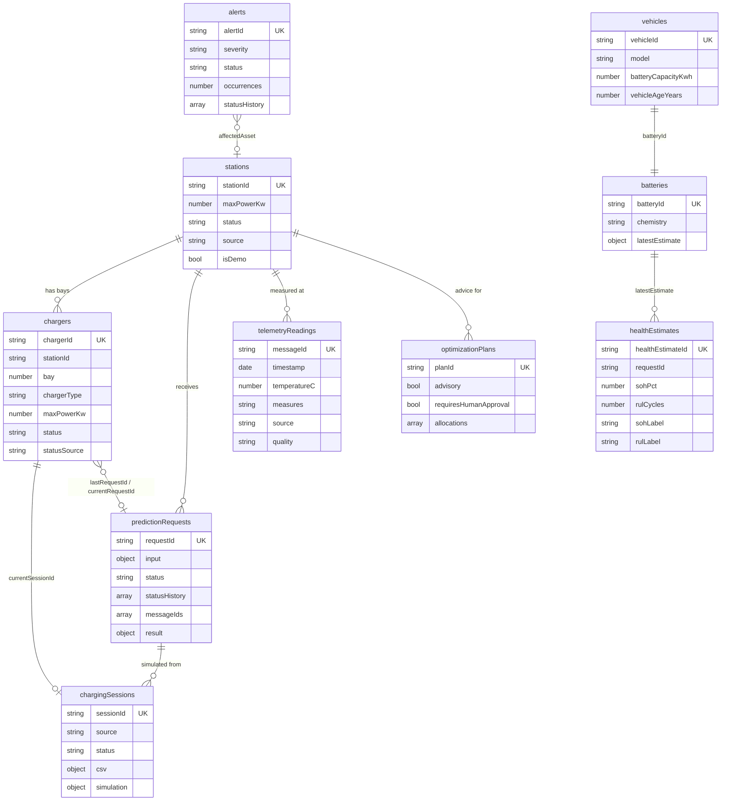

# Phase 7 — MongoDB Data Model and History

Goal of this phase: store everything the digital twin knows in MongoDB, and make every stored value say **where it came from** and **how much it can be trusted**. Phase 6 only had `predictionRequests` and a bare `stations` collection; this phase adds the full model, the seed/import scripts, MQTT ingestion for telemetry, alerts and health results, and the history endpoints the dashboard will read.

---

## 1. Source labels

Every collection that holds data values has the same three fields (`src/models/provenance.js`):

| Field | Values |
|---|---|
| `source` | `sensor`, `simulation`, `historical_csv`, `ml_estimate`, `manual` (exactly the five from the plan) |
| `quality` | `good`, `suspect`, `bad`, `unknown` |
| `qualityNotes` | the reason, in words, whenever quality isn't `good` |
| `isDemo` | `true` for anything written by the seed script |

`unknown` is the default and is used a lot on purpose. A simulated reading or a model output has not been checked against anything real, so calling it `good` would be overclaiming.

Wording that has to appear next to certain values lives in one file, `src/domain/labels.js`, taken from `docs/battery_model_limitations.md`:

| Value | Label used everywhere |
|---|---|
| SOH | "Model estimate from aging-data domain" |
| RUL | "Estimated RUL (model, lab conditions)" |
| Arduino temperature | "Ambient / charger-area temperature (not battery temperature)" |
| Session SOC | "Simulated SOC progress" |

The same file holds the default applicability notes for SOH/RUL and the "what must not be claimed" list from section 3 of the limitations doc. The API returns them, so the dashboard doesn't keep its own copy.

---

## 2. Collections



| Collection | What's in it | Default source |
|---|---|---|
| `stations` | the station, its name and site power limit (`maxPowerKw`, used by the optimiser later) | `manual` |
| `chargers` | one per bay: type, rating, connector, current status, who set the status, current/last request | `manual` |
| `vehicles` | vehicle profiles that pre-fill the request form | `manual` |
| `batteries` | one per vehicle profile, chemistry `unknown`, latest estimate summary | `manual` |
| `predictionRequests` | every charging prediction request + result + audit trail | result: `ml_estimate` |
| `chargingSessions` | the 1,320 CSV rows **and** simulated sessions, told apart by `source` | `historical_csv` / `simulation` |
| `telemetryReadings` | temperature readings from MQTT | `sensor` / `simulation` |
| `healthEstimates` | SOH/RUL results from `evdt/v1/results/health` | `ml_estimate` |
| `alerts` | one document per `alertId`, with occurrences and lifecycle | n/a (`raisedBy`) |
| `optimizationPlans` | shape only for now, filled in Phase 11 | n/a |

The plan listed nine collections. I added a tenth, `healthEstimates`. Keeping every SOH/RUL result inside its `batteries` document would make that document grow forever, and the health-result schema has no battery id anyway. So results are stored on their own, and `batteries.latestEstimate` can point at one.

### Things worth pointing out

**`predictionRequests` is an audit record.** `requestId`, `stationId` and `input` are `immutable`. Mongoose normally just ignores a change to an immutable field inside an update query and carries on, which is easy to miss, so I added a pre-update hook that **throws** instead:

```
predictionRequests is audit data; cannot modify input
```

The first version of this hook broke every request. Mongoose's `timestamps` option adds `$setOnInsert: { createdAt }` to every update, and my hook counted that as changing `createdAt`. `$setOnInsert` only applies when inserting, so it can't change an existing record; the hook now skips it.

**`statusHistory`** records every step with time, note and the MQTT `messageId`. A real request from the manual run below:

```js
statusHistory: [
  { status: 'pending',   note: 'created from dashboard request',          messageId: null },
  { status: 'pending',   note: 'published to evdt/v1/requests/charging',  messageId: 'dbbb9c5d-...' },
  { status: 'completed', note: 'worker status: completed',                messageId: 'bfe4342c-...' }
]
```

A timed-out and retried request also shows `timed_out`, `retry after timed_out`, a second publish with a new messageId, and (if it happens) `late result, arrived after the timeout`. The model versions are in `result.model`, so you can always see which model produced which number for which input.

**`result.source`** is `ml_estimate` for the real worker. While testing I noticed that results from the dev stub worker (Phase 6) were being counted as ML estimates on the provenance endpoint. That's wrong, since they come from a simple formula. The backend now looks at the model version and stores stub results (`dev-stub`) as `source: 'simulation'`.

**Chargers can't be set to `charging` by hand.** `PATCH .../chargers/:id` only accepts `available`, `fault`, `offline`. A bay only becomes `charging` through a simulated session, and `statusSource` records whether a person (`manual`) or the simulation set the state. Nothing reads a real charger.

**Telemetry `measures` is always `ambient`.** It's an enum with one value, so a reading can't be stored as anything else. Section 3.4 of the limitations doc says Arduino temperature must never be presented as battery temperature.

**Alerts:** `isConfirmedFault` is always `false`. An alert means "look at this", not "this is broken".

---

## 3. Indexes

Created by `npm run db:init` (and synced on every backend start):

```
alerts             _id_, alertId_1, status_1_lastSeenAt_-1
batteries          _id_, batteryId_1
chargers           _id_, chargerId_1, stationId_1_bay_1
chargingSessions   _id_, sessionId_1, source_1_startedAt_-1, stationId_1_status_1, chargerType_1
healthEstimates    _id_, healthEstimateId_1, requestId_1, processedAt_-1
optimizationPlans  _id_, planId_1, stationId_1_generatedAt_-1
predictionRequests _id_, requestId_1, stationId_1_createdAt_-1, status_1_createdAt_-1
stations           _id_, stationId_1
telemetryReadings  _id_, messageId_1, stationId_1_timestamp_-1, sim_readings_ttl
vehicles           _id_, vehicleId_1
```

- `requestId_1` is unique, as the plan asks. A second insert with the same id fails with `E11000` (tested).
- `messageId_1` on telemetry is unique, so a QoS 1 redelivery can't create a second reading.
- `sim_readings_ttl` is a TTL index with `partialFilterExpression: { source: 'simulation' }`. Simulated readings are removed after `TELEMETRY_SIM_TTL_DAYS` (7). Real sensor readings are kept. The plan said to use TTL "only for disposable telemetry", and only simulated readings are disposable.
- Station/time indexes support the history pages (`stationId + createdAt`, `stationId + timestamp`).

---

## 4. Seed and CSV import

```bash
npm run db:init         # indexes
npm run db:seed         # demo station + chargers + vehicles
npm run db:import-csv   # Data/ev_charging_patterns.csv -> chargingSessions
npm run db:setup        # all three
```

All of them can be run again safely (upserts by id).

### 4.1 Demo seed

| What | Records |
|---|---|
| Station | `STATION-001`, named "Demo charging station (not a real site)", 180 kW site limit |
| Chargers | BAY-1 Level 2 11 kW, BAY-2 Level 2 11 kW, BAY-3 DC 50 kW, BAY-4 DC 150 kW |
| Vehicles | Tesla Model 3 75 kWh, Nissan Leaf 40, Chevy Bolt 65, Hyundai Kona 64, BMW i3 42 (rounded typical values, "demo profile") |
| Batteries | one per vehicle, `chemistry: 'unknown'`, with a note that the SOH model only knows LiCoO2 18650 lab cells |
| Health estimate | one, copied from `shared/schemas/examples/health-result.json`, with a warning saying exactly that |

Everything seeded has `isDemo: true` and `source: 'manual'`.

What is **not** seeded: telemetry and alerts. Fake "live" readings are exactly what the plan says not to do, so the telemetry page will be empty until the simulator or the Arduino publishes something.

Re-seeding rewrites the static facts of a charger (type, rating) but not its live state, so it doesn't break a running session.

### 4.2 CSV import

All 1,320 rows go into `chargingSessions` with `source: 'historical_csv'`, `sessionId` `CSV-0001`…`CSV-1320`, and the original row number, `User ID` and `Charging Station ID` under `csv`. The CSV file is only read.

Rows are never dropped or corrected. Each row is checked against the Phase 1 domain rules and gets a quality:

| Check | Result if it fails |
|---|---|
| battery capacity > 0, 0 ≤ start SOC < end SOC ≤ 100, no negative energy/duration/rate/cost, end after start | `bad` |
| missing energy / rate / distance | `suspect` |
| recorded duration differs from `end − start` by more than 15 min | `suspect` |
| energy differs from `duration × rate` by more than 50 % | `suspect` |

```
imported { rows: 1320, inserted: 1320, alreadyPresent: 0, quality: { suspect: 999, bad: 291, good: 30 } }
```

Reasons, counted per note:

```
 1142 recorded duration vs end-start
  763 energy vs duration x rate
  291 SOC rule broken
   66 missing distanceDrivenKm
   66 missing energyKwh
   66 missing chargingRateKw
```

The 291 SOC failures match Phase 1 exactly (268 start ≥ end + 23 end > 100). Phase 1 flagged 1,269 rows overall and this import flags 1,290. The difference comes from the tolerances on the two consistency checks, which aren't identical to the Python script's. Running the import a second time gives `inserted: 0, alreadyPresent: 1320`.

The CSV times have no timezone. I store them as UTC so every machine shows the same hour, and the summary endpoint calls the field `byHourUtc` so nobody reads it as local time.

**Something the summary showed straight away:**

| Charger type | Sessions | Avg energy | Avg duration | Avg rate |
|---|---:|---:|---:|---:|
| DC Fast Charger | 430 | 41.29 kWh | 2.28 h | 25.55 kW |
| Level 1 | 459 | 41.61 kWh | 2.24 h | 26.00 kW |
| Level 2 | 431 | 45.08 kWh | 2.28 h | 26.33 kW |

Level 1 at 26 kW is physically impossible (real Level 1 is roughly 1–2 kW), and DC fast should be much faster. In this dataset the charger type is not connected to the rate at all. It fits Phase 1/2 (synthetic, loosely coupled columns, R² ≈ 0) and is worth saying out loud when the history charts are shown.

---

## 5. MQTT ingestion

`src/services/ingestService.js` now handles three more topics. Each message is checked against its schema in `shared/schemas/`, duplicates are dropped, and the result is pushed to the browser.

| Topic | Stored in | Dedup | Extra rules |
|---|---|---|---|
| `evdt/v1/telemetry/temperature` | `telemetryReadings` | unique `messageId` | quality: `unknown` unless calibrated; `suspect` outside −30…55 °C or timestamp > 2 min in the future; `bad` if `simulated` contradicts `source` |
| `evdt/v1/alerts` | `alerts` | same `messageId` = ignore; same `alertId` = `occurrences + 1` | a new `open` on a resolved alert re-opens it, with a history entry |
| `evdt/v1/results/health` | `healthEstimates` | unique `messageId` | `source: 'ml_estimate'` forced; default applicability notes added if the worker sends none; `eolThresholdIsAssumption: true` |

Repeated alerts become one document with a counter. That is the "no alert storm" requirement from Phase 12, prepared here at storage level.

Alert lifecycle over REST: `PATCH /api/alerts/:alertId` with `acknowledged` or `resolved`. `open → acknowledged → resolved` and `open → resolved` are allowed; anything else is `409 INVALID_TRANSITION`.

---

## 6. Simulated sessions

A completed prediction can be "played" on a bay so the dashboard and the 3D twin (Phase 9) have a charger state to show:

```
POST /api/sessions/simulated  { "requestId": "...", "chargerId": "STATION-001-BAY-3" }
POST /api/sessions/:sessionId/stop
```

- The bay is claimed with one atomic update (`status: 'available' → 'charging'`), so two sessions can't take the same bay.
- The bay must be of the request's charger type. When a prediction names a bay up front, the rate is also checked against the bay rating (`RATE_ABOVE_CHARGER_RATING`, `CHARGER_TYPE_MISMATCH`, `UNKNOWN_CHARGER`).
- SOC and energy are computed from the clock: `progress = elapsed × SIM_TIME_SCALE / predicted duration`. With the default scale of 60, a 52-minute predicted charge plays in 52 seconds. The session view always has `label: "Simulated SOC progress"` and `source: "simulation"`.
- A sweeper runs every 2 s and finishes sessions whose simulated time is up. It only looks at `expectedEndAt` in the database, so after a restart it catches up instead of leaving a bay stuck on `charging`. The plan's Phase 9 pitfall was exactly that: a charger that keeps animating forever.
- Setting a busy bay to `fault`/`offline` stops its session. Setting it to `available` while charging is refused; you stop the session instead.

A session is only started on purpose. A prediction on its own never changes a bay's status, so a timed-out request can't leave a charger "charging".

The retained `evdt/v1/stations/{id}/status` message (Phase 6) now includes the charger states and the latest temperature with its source. Bursts of changes are folded into one publish per second.

---

## 7. New API endpoints

| Method | Path | Purpose |
|---|---|---|
| GET | `/api/predictions?status=&limit=&before=` | request history, newest first, keyset paging |
| GET | `/api/stations/:id` | station + chargers (with live session progress) + latest temperature |
| GET | `/api/stations/:id/chargers` | just the bays |
| PATCH | `/api/stations/:id/chargers/:chargerId` | operator sets `available` / `fault` / `offline` |
| GET | `/api/sessions?source=&chargerType=&vehicleModel=&page=` | historical and simulated sessions |
| GET | `/api/sessions/summary` | CSV aggregates by charger type, vehicle model, hour (UTC), quality |
| GET | `/api/sessions/:id` | one session |
| POST | `/api/sessions/simulated`, `/api/sessions/:id/stop` | simulated sessions |
| GET | `/api/telemetry?since=&limit=`, `/api/telemetry/latest` | readings, each with its label/source/quality |
| GET / PATCH | `/api/alerts`, `/api/alerts/:alertId` | list, acknowledge, resolve |
| GET | `/api/battery-health` | estimates + labels + domain + "not claimed" list |
| GET | `/api/vehicles` | demo vehicle profiles |
| GET | `/api/optimization/plans` | empty until Phase 11, always `advisoryOnly: true` |
| GET | `/api/provenance` | counts per collection by source / quality / demo |
| GET | `/api/meta` | allowed values and limits from the shared schema, labels, timeout, sim scale |

`/api/meta` exists so the Phase 8 form can be built from the schema instead of hard-coding the vehicle list again.

New Socket.IO events: `station:update`, `telemetry:reading` (both to the station room), `alert:update`, `health:update` (to everyone).

---

## 8. Tests

```bash
npm test
# tests 41, pass 41, fail 0  (about 20 s)
```

New file `test/datamodel.test.js` (17 tests), on top of the 24 from Phase 6:

| Test | Checks |
|---|---|
| CSV row checks (4) | good row; SOC down → `bad`; missing value / duration mismatch → `suspect`; real CSV line mapped with row number and UTC time |
| seed twice | still 4 chargers, all `isDemo`, no telemetry seeded |
| audit trail | history `pending → pending → completed`, messageId recorded, `$set input.*` throws, duplicate `requestId` → E11000 |
| history paging | newest first, `before` gives the next page |
| bay checks | rate above rating, wrong charger type |
| simulated session | bay → `charging` (source simulation), second start `409`, ends after its time, bay back to `available`, end SOC = target |
| fault during session | `charging` can't be set by hand; `fault` stops the session |
| telemetry | stored with `ambient`; repeat ignored; 70 °C → `suspect`; `source: sensor` + `simulated: true` → `bad`; non-number rejected |
| alerts | repeat → one doc, `occurrences: 2`; ack → resolve; resolve → ack is `409` |
| health | labels exact; default notes added; duplicate ignored |
| retained status | schema-valid, 4 chargers, temperature source |
| provenance | counts per source |
| meta | enums/limits straight from the schema |
| TTL | index exists and only matches `source: simulation` |

Plus one new Phase 6 test: a result with model version `dev-stub` is stored as `source: simulation`.

**A flaky shutdown I had to fix.** Once in a while `predictions.test.js` passed every test and then never exited. `mqtt.endAsync()` without `force` waits for in-flight QoS 1 messages to be acknowledged. When the broker has just been killed (the broker-down test), that never happens. A real backend shut down during a broker outage would hang the same way. `MqttService.close()` now waits at most 2 s and then forces the connection closed. I also added `--test-timeout=30000` to `npm test`, so a hang shows up as a failure with a name instead of blocking. Three full runs after the fix: 41/41 each time.

---

## 9. Manual run

Backend + stub worker + simulated telemetry (`npm run dev:sim-telemetry -- --every=2`) against the local Mosquitto, database `evdt_dev` seeded and imported.

Prediction for a Chevy Bolt on BAY-3, then a simulated session. 26 s in (of 52):

```json
{
  "chargerId": "STATION-001-BAY-3", "type": "DC Fast Charger", "kW": 50,
  "status": "charging", "statusSource": "simulation",
  "session": { "label": "Simulated SOC progress", "source": "simulation", "timeScale": 60,
               "progressPct": 49.8, "socPct": 49.9, "energyKwh": 21.6 }
}
"telemetry": {
  "temperatureC": 27.51, "units": "°C", "measures": "ambient",
  "label": "Ambient / charger-area temperature (not battery temperature)",
  "source": "simulation", "quality": "unknown", "qualityNotes": ["sensor calibration: unknown"],
  "sensorId": "SIM-AMBIENT-01", "ageSec": 1
}
```

Retained status read with `mosquitto_sub` at the same moment:

```json
{"schemaVersion":"1.0","stationId":"STATION-001","status":"online",
 "chargers":[{"chargerId":"STATION-001-BAY-1","status":"available","currentSessionRequestId":null},
             {"chargerId":"STATION-001-BAY-3","status":"charging","currentSessionRequestId":"a1046cd9-7790-40de-a05f-b13f0f8010d5"}, ...],
 "telemetry":{"temperatureC":27.51,"temperatureSource":"simulation","lastTemperatureAt":"2026-11-17T17:45:59.528Z"}}
```

After the 52 s the sweeper ended it (`17:45:34 → 17:46:26`): session `completed`, `endSocPct: 80`, `energyKwh: 43.33`, bay back to `available` with note "simulated session completed".

Provenance at the end of the run:

```
stations           manual/unknown/demo=1
chargers           manual/unknown/demo=4
vehicles           manual/unknown/demo=5
batteries          manual/unknown/demo=5
chargingSessions   historical_csv/good=30  historical_csv/suspect=999  historical_csv/bad=291  simulation/unknown=1
telemetryReadings  simulation/unknown=52
healthEstimates    manual/unknown/demo=1
predictionRequests ml_estimate=1  simulation=5     (5 came from the stub worker)
```

Every row in the database can be traced to one of the five sources.

---

## 10. Files

```
laptop-1/backend/
├── src/
│   ├── domain/labels.js              # wording from battery_model_limitations.md
│   ├── models/
│   │   ├── provenance.js             # source / quality / isDemo fields
│   │   ├── statusEntry.js            # audit trail entry
│   │   ├── index.js
│   │   ├── Station.js, Charger.js, Vehicle.js, Battery.js
│   │   ├── PredictionRequest.js      # + statusHistory, audit guard
│   │   ├── ChargingSession.js, TelemetryReading.js, HealthEstimate.js
│   │   └── Alert.js, OptimizationPlan.js
│   ├── db/seed.js, db/importCsv.js
│   ├── services/ingestService.js     # telemetry, alerts, health from MQTT
│   ├── services/stationService.js    # charger state, simulated sessions, station view
│   └── routes/sessions.js, telemetry.js, alerts.js, reference.js (+ updated stations, predictions)
├── scripts/db.js                     # db:init / db:seed / db:import-csv
├── scripts/sim-telemetry.js          # simulated ambient temperature
└── test/datamodel.test.js
```

New `.env` options: `SIM_TIME_SCALE` (60) and `TELEMETRY_SIM_TTL_DAYS` (7).

## 11. Plan checklist

| From the plan | Done |
|---|---|
| Collections: stations, chargers, vehicles, batteries, chargingSessions, predictionRequests, telemetryReadings, alerts, optimizationPlans | yes, plus `healthEstimates` |
| `source` (5 values), `quality`, `units` on readings and predictions | yes |
| Unique `requestId`, station/time indexes, TTL only for disposable telemetry | yes, TTL limited to simulated readings |
| `predictionRequests` auditable, `statusHistory` | immutable input + throwing guard + full history |
| Clearly labelled demo seed, never shown as live | `isDemo`, `manual`, no fake telemetry |
| Schema diagram | section 2 |
| Seed/migration scripts | `npm run db:setup` |
| Queries power dashboard history | history, summary, telemetry, alerts, provenance endpoints |
